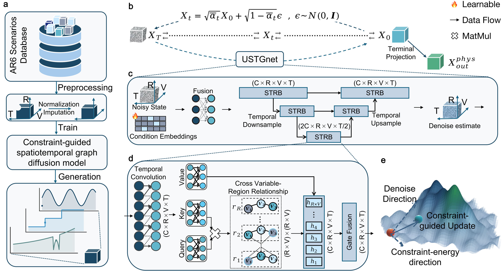

# DeepIAM

DeepIAM is a constraint-guided spatiotemporal graph diffusion model for generating climate mitigation pathways. This repository includes data preprocessing, model training, sampling, and evaluation code.



## Data

Source data: [AR6 Scenario Explorer and Database](https://iiasa.ac.at/models-tools-data/ar6-scenario-explorer-and-database).

## Installation and demo (Linux)

```bash
git clone https://github.com/XudongZhang-PKU/AI_for_climate_change.git
cd AI_for_climate_change

conda create -n deepiam python=3.14 -y
conda activate deepiam
pip install -r requirements.txt

# Set your data and checkpoint paths; use the seeds associated with the checkpoint
python scripts/run_model.py demo \
  --data-root /path/to/SPM \
  --checkpoint /path/to/model.ckpt \
  --checkpoint-split-seed 2026 \
  --normalization-seed 2026 \
  --seed 2026 --split-seed 2026 \
  --device cuda \
  --output-dir outputs/demo
```

## Training

```bash
python scripts/run_model.py train \
  --data-root /path/to/SPM \
  --device cuda --epochs 300 \
  --seed 2026 --split-seed 2026 \
  --output-dir outputs/train
```

## Repository structure

| Directory | Contents |
|---|---|
| `model_files/` | Model architecture and data loading |
| `scripts/` | Training and sampling entry points |
| `utils/` | Constraints, evaluation, and output export |
| `analysis/` | Distributional validation, ablations, and sensitivity analysis |
| `preprocessing/`, `plotting/` | Data preprocessing and plotting |
| `legacy/`, `sensitivity/` | Historical scripts and cluster jobs |

See the [usage guide](docs/usage.md) for input formats and evaluation commands.

## License

[MIT](LICENSE)
